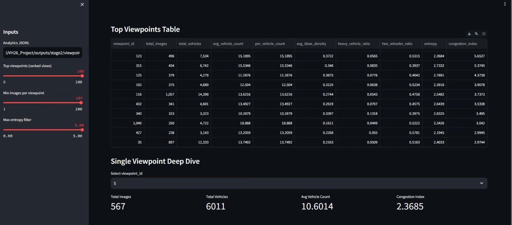
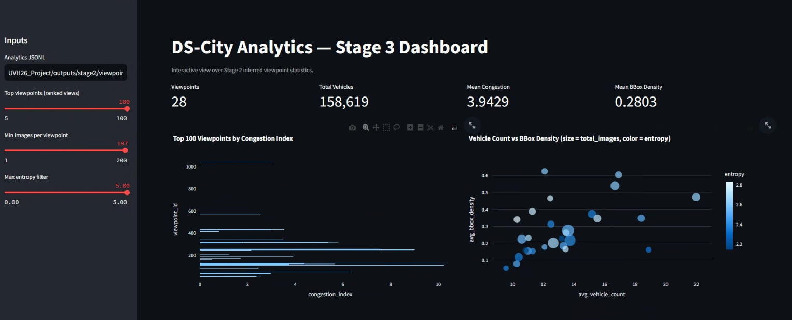

# DS-City Analytics

This repository contains:
- **Stage 1**: deterministic viewpoint reconstruction from UVH-26 images.
- **Stage 2**: Spark-based viewpoint analytics (smoke and full-scale runs).
- **Stage 3**: interactive dashboard to explore inferred traffic statistics.

## Motivation and Problem
- Large traffic datasets become slow and difficult to analyze with single-machine workflows.
- Stage 1 reconstructs camera viewpoints, but raw `image_id -> viewpoint_id` pairs are not ideal for distributed scheduling.
- Stage 2 addresses this by using Spark for distributed aggregation and by building a one-to-many viewpoint index that is easier to split across nodes.

## What this solves
- scalable per-viewpoint analytics over tens of thousands of images,
- reproducible smoke-to-full validation flow,
- clear run evidence for distributed execution claims.

## Reproduce from scratch

Everything needed is this repository plus UVH-26 from Hugging Face, pinned to commit
`59f82c57821e8a54dc40bc1f42e83909dbad0b70` (set in `UVH26_Project/src/dataset_loader.py`; annotation SHA-256s are checked on download).
Both stages were rerun from a clean state and reproduced the committed outputs byte for byte.

Prerequisites: Python 3.9 (tested 3.9.13), Java 8/11/17 for Stage 2 (tested 17). An NVIDIA GPU is recommended for Stage 1 (CPU works, slower).

```bash
git clone https://github.com/not-good-keeper/DS-City-Analytics.git
cd DS-City-Analytics
python -m venv .venv
source .venv/bin/activate          # PowerShell: .\.venv\Scripts\Activate.ps1
pip install -r requirements.txt -r requirements-stage2.txt -r requirements-stage3.txt

# 1. Dataset at the pinned revision (drop --images to fetch annotations only, enough for Stage 2/3)
python UVH26_Project/src/fetch_dataset.py --images

# 2. Stage 1 from scratch into a separate folder (the committed checkpoint is already complete,
#    so the default run id just resumes and exits)
cd UVH26_Project && python src/main.py --run-id repro --outputs-dir outputs/repro && cd ..

# 3. Stage 2 on local Spark (no Spark install needed; pip pyspark starts its own JVM)
python spark_jobs/analytics_job.py --master "local[*]" --skip-output-write \
  --preview-jsonl ../UVH26_Project/outputs/repro/viewpoint_analytics_full_4780vp.jsonl --preview-limit 10000

# 4. Compare against the committed artifacts
python scripts/verify_reproduction.py \
  --stage1 UVH26_Project/outputs/repro/image_viewpoint_mapping_repro.csv \
  --stage2 UVH26_Project/outputs/repro/viewpoint_analytics_full_4780vp.jsonl

# 5. Dashboard
streamlit run stage3/dashboard_app.py
```

For Stage 2/3 only: skip step 2, drop `--images`, and leave out `--stage1`.

Notes:
- Spark job paths resolve relative to `spark_jobs/`, hence the `../UVH26_Project/...` arguments.
- On Windows, writing Parquet needs `winutils.exe`/`HADOOP_HOME`; `--skip-output-write` avoids it. If `SPARK_HOME` points at a missing install, unset it.
- Stage 1 uses deterministic cuDNN and a fixed image order (train JSON order, then val).

## 1) Prerequisites
- Python 3.9 (tested 3.9.13)
- Java 8/11/17 (tested 17)
- PySpark 3.5.8 (from `requirements-stage2.txt`); a standalone Spark 3.5 cluster only for distributed runs

## 2) Install
From repo root:

```powershell
& .\.venv\Scripts\Activate.ps1
pip install -r requirements.txt -r requirements-stage2.txt -r requirements-stage3.txt
```

## 3) Stage 1 (build mapping)
From repo root:

PowerShell:
```powershell
Push-Location .\UVH26_Project
& ..\.venv\Scripts\python.exe src\main.py
Pop-Location
```

Bash:
```bash
cd UVH26_Project
../.venv/bin/python src/main.py
cd ..
```

Main Stage 1 outputs:
- `UVH26_Project/outputs/image_viewpoint_mapping_masked40_rerun.csv`
- `UVH26_Project/outputs/viewpoint_registry_masked40_rerun.pkl`

## 4) Stage 2 (grouped mapping + analytics)

### 4.1 Build Spark-friendly viewpoint mapping (one-to-many)
PowerShell:
```powershell
& .\.venv\Scripts\python.exe .\spark_jobs\build_viewpoint_mapping.py --input-csv ..\UVH26_Project\outputs\image_viewpoint_mapping_masked40_rerun.csv --output-dir ..\UVH26_Project\outputs\stage2\mappings_full_26646 --num-node-buckets 2
```

Bash:
```bash
./.venv/bin/python ./spark_jobs/build_viewpoint_mapping.py --input-csv ../UVH26_Project/outputs/image_viewpoint_mapping_masked40_rerun.csv --output-dir ../UVH26_Project/outputs/stage2/mappings_full_26646 --num-node-buckets 2
```

### 4.2 Smoke test (small subset)
Create smoke mapping from full Stage 1 mapping:
PowerShell:
```powershell
& .\.venv\Scripts\python.exe .\spark_jobs\create_smoke_mapping.py --input-csv ..\UVH26_Project\outputs\image_viewpoint_mapping_masked40_rerun.csv --output-csv ..\UVH26_Project\outputs\image_viewpoint_mapping_stage2_smoke_100img_10vp.csv --max-viewpoints 10 --max-images 100
```

Bash:
```bash
./.venv/bin/python ./spark_jobs/create_smoke_mapping.py --input-csv ../UVH26_Project/outputs/image_viewpoint_mapping_masked40_rerun.csv --output-csv ../UVH26_Project/outputs/image_viewpoint_mapping_stage2_smoke_100img_10vp.csv --max-viewpoints 10 --max-images 100
```

Run smoke analytics:
PowerShell:
```powershell
spark-submit --master spark://<master-host>:7077 .\spark_jobs\analytics_job.py --mapping-csv ..\UVH26_Project\outputs\image_viewpoint_mapping_stage2_smoke_100img_10vp.csv --output-dir ..\UVH26_Project\outputs\stage2\viewpoint_analytics_smoke_10vp --preview-jsonl ..\UVH26_Project\outputs\stage2\viewpoint_analytics_smoke_10vp_preview.jsonl --preview-limit 20
```

Bash:
```bash
spark-submit --master spark://<master-host>:7077 ./spark_jobs/analytics_job.py --mapping-csv ../UVH26_Project/outputs/image_viewpoint_mapping_stage2_smoke_100img_10vp.csv --output-dir ../UVH26_Project/outputs/stage2/viewpoint_analytics_smoke_10vp --preview-jsonl ../UVH26_Project/outputs/stage2/viewpoint_analytics_smoke_10vp_preview.jsonl --preview-limit 20
```

### 4.3 Full run (all viewpoints)
PowerShell:
```powershell
spark-submit --master spark://<master-host>:7077 .\spark_jobs\analytics_job.py --mapping-csv ..\UVH26_Project\outputs\image_viewpoint_mapping_masked40_rerun.csv --output-dir ..\UVH26_Project\outputs\stage2\viewpoint_analytics_full_4780vp --preview-jsonl ..\UVH26_Project\outputs\stage2\viewpoint_analytics_full_4780vp.jsonl --preview-limit 10000
```

Bash:
```bash
spark-submit --master spark://<master-host>:7077 ./spark_jobs/analytics_job.py --mapping-csv ../UVH26_Project/outputs/image_viewpoint_mapping_masked40_rerun.csv --output-dir ../UVH26_Project/outputs/stage2/viewpoint_analytics_full_4780vp --preview-jsonl ../UVH26_Project/outputs/stage2/viewpoint_analytics_full_4780vp.jsonl --preview-limit 10000
```

For local-only validation (no cluster), use `--master local[*]`.

## 5) What proves distributed execution
Capture and share:
- Spark submit command with non-local master (`spark://...`).
- `spark_jobs/logs/stage2_analytics_*.log` containing:
  - `Spark master`
  - `Default parallelism`
  - `Shuffle partitions`
  - `Input mapping rows`, `Joined annotation rows`, `Output viewpoint rows`
- one preview file (`*_preview.jsonl`) for readable metric samples.

Stage 2 logs are written to `spark_jobs/logs/` and are not committed (see `.gitignore`); keep them locally as run evidence.

## 5.2 Committed full analytics artifact
This repository includes the main full Stage 2 analytics output:
- `UVH26_Project/outputs/stage2/viewpoint_analytics_full_4780vp.jsonl`

Artifact details:
- Generated from full Stage 1 mapping (`26,646` images).
- Contains `4,780` viewpoint rows.
- One JSON object per viewpoint with metrics:
  - `viewpoint_id`
  - `total_images`
  - `total_vehicles`
  - `avg_vehicle_count`
  - `per_vehicle_count`
  - `avg_bbox_density`
  - `heavy_vehicle_ratio`
  - `two_wheeler_ratio`
  - `entropy`
  - `congestion_index`
  - `class_distribution_vector`

## 5.1 Detailed Stage 2 metrics
- `total_images`: frames in viewpoint.
- `total_vehicles`: total detections in viewpoint.
- `avg_vehicle_count`: mean vehicles per image.
- `per_vehicle_count`: `total_vehicles / total_images`.
- `avg_bbox_density`: mean `(sum_bbox_area / image_area)` per image.
- `heavy_vehicle_ratio`: heavy vehicle share.
- `two_wheeler_ratio`: two-wheeler share.
- `entropy`: Shannon entropy over class distribution.
- `congestion_index`: `avg_vehicle_count * avg_bbox_density`.
- `class_distribution_vector`: JSON class probability vector.

## 6) Repository policy
- Raw UVH-26 data is not committed; it is fetched from Hugging Face at the pinned revision.

## 7) Stage 3 Dashboard (Insights)
Stage 3 provides an interactive dashboard over Stage 2 metrics so you can inspect inferred traffic statistics quickly.

Install Stage 3 dependencies:

PowerShell:
```powershell
& .\.venv\Scripts\Activate.ps1
pip install -r requirements-stage3.txt
```

Bash:
```bash
source .venv/bin/activate
pip install -r requirements-stage3.txt
```

Run dashboard:

PowerShell:
```powershell
streamlit run .\stage3\dashboard_app.py
```

Bash:
```bash
streamlit run ./stage3/dashboard_app.py
```

Default URL: `http://localhost:8501`

### Stage 3 Dashboard Screenshots

Overview (KPIs + ranking + scatter):



Table + Deep Dive view:




## Documentation
- Stage 1 dev docs: `STAGE1_DEV_DOCS.md`
- Stage 1 setup: `docs/STAGE1_SETUP.md`
- Stage 2 dev docs: `STAGE2_DEV_DOCS.md`
- Stage 2 setup: `docs/STAGE2_SETUP.md`
- Stage 3 dev docs: `STAGE3_DEV_DOCS.md`

## Dataset Acknowledgment
This project uses the **UVH-26** dataset released by **AIM @ IISc**.

I sincerely thank the UVH-26 authors and contributors for making this dataset publicly available, which enables reproducible research and development for Indian traffic-scene analytics.

## Citation
If you use UVH-26 in your work, please cite:

```bibtex
@techreport{sharma2025uvh26,
   title        = {Towards Image Annotations and Accurate Vision Models for Indian Traffic, Preliminary Dataset Release, UVH-26-v1.0},
   author       = {Akash Sharma and Chinmay Mhatre and Sankalp Gawali and Ruthvik Bokkasam and Brij Kishore and Vishwajeet Pattanaik and Tarun Rambha and Abdul R. Pinjari and Vijay Kovvali and Anirban Chakraborty and Punit Rathore and Raghu Krishnapuram and Yogesh Simmhan},
   institution  = {Indian Institute of Science},
   type         = {Technical Report},
   number       = {arXiv:2511.02563},
   year         = {2025},
   month        = {November},
   doi          = {10.48550/arXiv.2511.02563}
}
```
